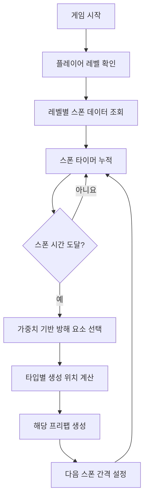
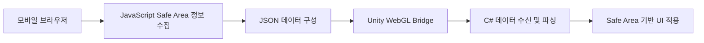

# 🐟 크레용피쉬(CrayonFish)

**플레이어의 성장과 방해 요소를 활용한 2D 하이퍼캐주얼 아케이드 게임**


> 크레용피쉬(CrayonFish)는 플레이어가 자신과 같거나 낮은 레벨의 먹이를 섭취하며 성장하는 2D 하이퍼캐주얼 아케이드 게임입니다.
> 본 저장소는 실제 서비스된 게임의 클라이언트 프로젝트 중 **직접 담당한 방해 요소 시스템과 WebGL Safe Area 대응 기능을 중심으로 담당 코드를 정리하고 리팩토링한 결과물**입니다.

## 🔗 Project Links

| 구분 | 링크 |
|---|---|
| Notion Portfolio | [크레용피쉬 프로젝트 상세 포트폴리오](https://app.notion.com/p/qomop-ramming-dev/CrayonFish-41c784b9ff7180849a37f60b2941015b?source=copy_link) |
| Game Demo | [Itch.io - CrayonFish](https://cham-qomop.itch.io/crayonfish) |

## 📌 Project Overview

| 항목 | 내용 |
|---|---|
| 프로젝트 | 크레용피쉬 (CrayonFish) |
| 개발 기간 | 2025.06.30 ~ 2025.07.29 (약 1개월) |
| 개발 인원 | 클라이언트 개발자 4명 |
| 장르 | 2D 하이퍼캐주얼 아케이드 |
| 개발 엔진 |  |
| 개발 언어 |   |
| 타겟 플랫폼 | Unity WebGL / Mobile Web |
| 서비스 플랫폼 | 앱인토스 (app-in-toss) |

## 👨‍💻 My Contributions

프로젝트에서 담당한 주요 업무입니다.

| 담당 영역 | 주요 구현 내용 |
|---|---|
| 방해 요소 스폰 시스템 | 플레이어 레벨에 따른 생성 주기 및 확률 가중치 기반 스폰 |
| 방해 요소 4종 | 복어, 해마, 낚시꾼, 문어의 주요 동작 로직 |
| WebGL 플랫폼 대응 | JavaScript와 Unity 간 Safe Area 데이터 연동 |
| 게임 이미지 리소스 | AI 도구를 활용한 이미지 수정 및 게임 콘셉트에 맞는 리소스 제작·적용 |

※ 본 저장소는 프로젝트 전체 코드가 아닌, 직접 담당한 기능을 중심으로 구성한 코드입니다.

## 🚀 Key Implementations

### 1. 레벨 기반 방해 요소 스폰 시스템

플레이어의 성장 단계에 따라 방해 요소의 등장 빈도와 종류가 달라지도록 스폰 시스템을 구현했습니다.

**주요 구현 내용**
- 플레이어 레벨에 따른 스폰 간격 설정
- 레벨별 방해 요소 등장 확률 관리
- 가중치 기반 랜덤 타입 선택
- 방해 요소 종류에 따른 생성 위치 계산 및 프리팹 생성

**스폰 시스템 흐름**



**방해 요소별 생성 위치**

| 방해 요소 | 생성 위치 |
|---|---|
| Blowfish | 화면 내부 랜덤 위치 |
| Seahorse | 화면 좌측 또는 우측 |
| Fisher | 화면 상단 |
| Octopus | 화면 하단 |

**핵심 코드:** `ObstaclesManager.cs`

---

### 2. 방해 요소별 동작 구현

각 방해 요소가 서로 다른 방식으로 플레이어의 진행을 방해하도록 개별 동작 로직을 구현했습니다.

#### 🐡 Blowfish - 경고 후 등장 및 범위 폭발

| 구현 로직 및 특징 | 인게임 시연 (GIF) |
|---|---|
| - 경고 UI를 표시한 뒤 애니메이션 이벤트에 맞춰 등장 <br> - 지정된 목표 위치까지 이동 <br> - 플레이어와 충돌하면 이동을 중단하고 둔화 효과 적용 <br> - 폭발 범위 내 플레이어 감지 및 피해 판정 |  |

#### 🐴 Seahorse - 물대포 공격 및 넉백 처리

| 구현 로직 및 특징 | 인게임 시연 (GIF) |
|---|---|
| - 공격 전 경고 UI 표시 <br> - 일정 시간 후 물대포 충돌 영역과 시각 효과 활성화 <br> - 공격 유지 시간이 종료되면 효과 및 충돌 영역 정리 <br> - 플레이어의 위치에 따라 물리력을 적용해 밀어내는 동작 구현 <br> - 물대포 영역 내 플레이어 위치 보정 |  |

#### 🎣 Fisher - 플레이어 레벨 연동형 낚싯줄

| 구현 로직 및 특징 | 인게임 시연 (GIF) |
|---|---|
| - 플레이어 레벨에 따라 낚싯줄의 최대 길이 계산 <br> - 랜덤 목표 길이까지 낚싯줄 하강 <br> - 사인 함수를 활용한 좌우 흔들림 구현 <br> - 낚싯바늘과 플레이어의 충돌 처리 |  |

#### 🐙 Octopus - 먹물 공격 및 화면 가림 효과

| 구현 로직 및 특징 | 인게임 시연 (GIF) |
|---|---|
| - 먹물 공격 실행 후 문어 오브젝트 소멸 <br> - 먹물 화면 효과 활성화 <br> - 설정된 시간 동안 화면 가림 효과 유지 <br> - 유지 시간이 종료되면 페이드아웃을 통해 자동 종료 |  |

---

### 3. WebGL Safe Area 대응

모바일 기기의 노치 및 화면 영역 차이에 대응하기 위해 JavaScript에서 Safe Area 정보를 수집하고, 이를 Unity WebGL에 전달하여 UI에 적용하는 기능을 구현했습니다.

**주요 구현 내용**
- JavaScript에서 모바일 브라우저의 Safe Area 정보 수집
- 수집한 데이터를 JSON 형태로 구성하여 Unity WebGL에 전달
- C#에서 전달받은 JSON 데이터 파싱
- 파싱한 Safe Area 정보를 기반으로 UI 영역 적용
- 실제 모바일 기기에서 UI 표시 영역 검증

**데이터 처리 흐름**



**관련 코드**

| 파일 | 역할 |
|---|---|
| `UnitySafeAreaController.cs` | Safe Area 데이터 수신 및 UI 적용 |
| `NativeSafeAreaBridge.jslib` | JavaScript와 Unity 간 데이터 전달 |
| `TossFrameworkBridge.js` | 앱인토스 프레임워크 연동 |
| `index.html` | WebGL 실행 환경 구성 |

## 🛠️ Tech Stack

| 분류 | 기술 |
|---|---|
| Game Engine | Unity 2022.3.60f1 |
| Language | C#, JavaScript |
| Platform | Unity WebGL, App in Toss |
| Version Control | Git, GitHub |
| Development Workflow | Branch, Pull Request |

## 📂 Project Structure

```text
Assets/
├── Assets-Showcase/
│
├── Client-Scripts/
│   ├── Managers/
│   │   └── ObstaclesManager.cs
│   │
│   └── Obstacles/
│       ├── Combat/
│       │   ├── Blowfish.cs
│       │   ├── Seahorse.cs
│       │   ├── Octopus.cs
│       │   └── Fisher.cs
│       │
│       └── Patterns/
│           ├── Watercannon.cs
│           └── InkTrap.cs
│
└── Server-Scripts/
    ├── Managers/
    │   └── UnitySafeAreaController.cs
    │
    ├── WebBridge/
    │   └── NativeSafeAreaBridge.jslib
    │
    └── Web-Frontend/
        ├── index.html
        └── TossFrameworkBridge.js
```

## 📝 Additional Information

본 저장소는 인턴십 당시 담당했던 기능을 중심으로 코드를 정리하고 리팩토링한 결과물입니다.

프로젝트의 상세한 기획, 구현 과정, 코드 분석, 기술적 문제 해결 및 회고는 상단의 Notion Portfolio에서 확인할 수 있습니다.

<sub>크레용피쉬(CrayonFish) | Unity Client Development Portfolio</sub
